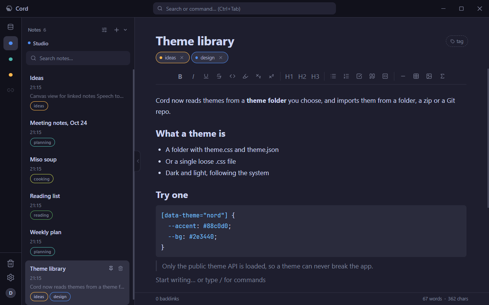
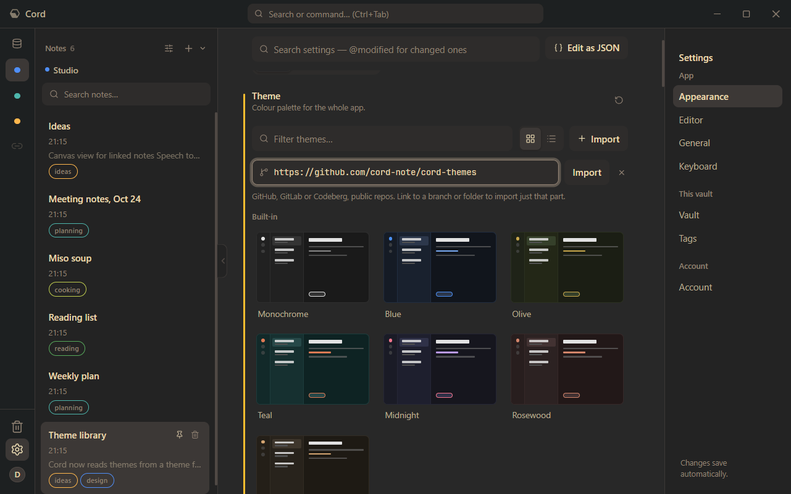
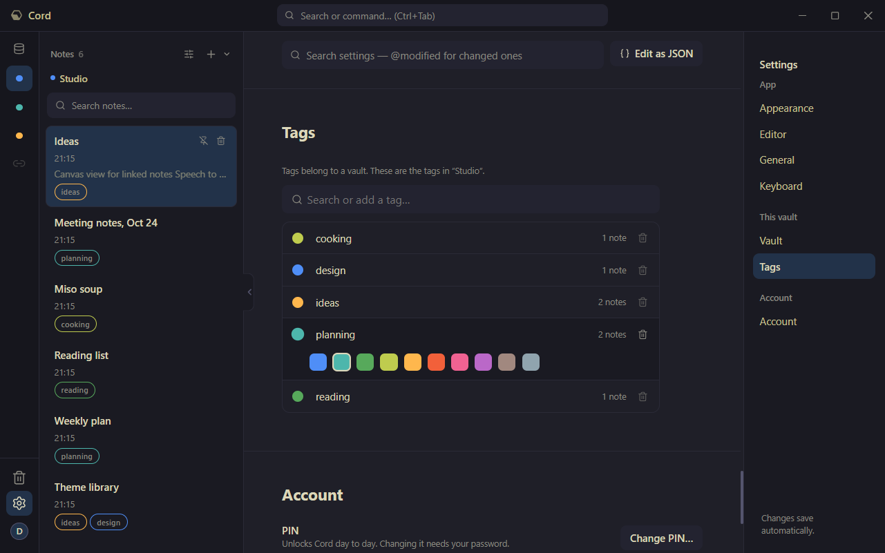
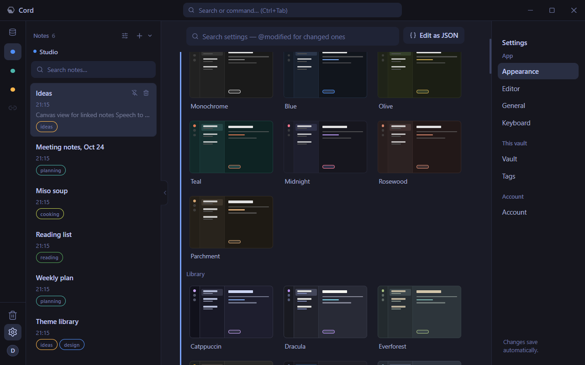
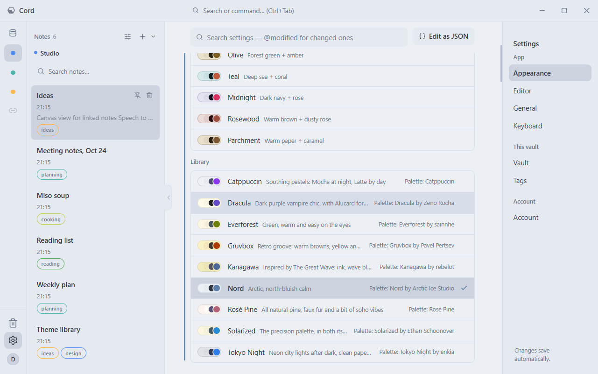
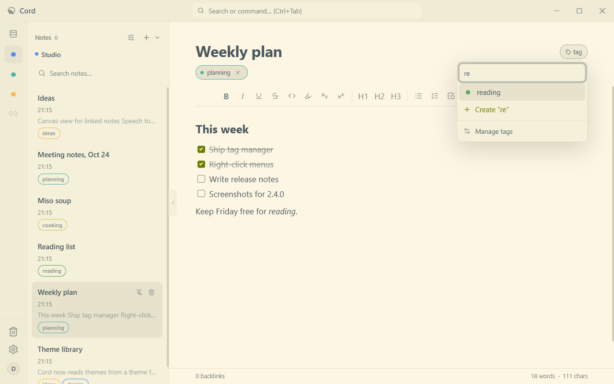
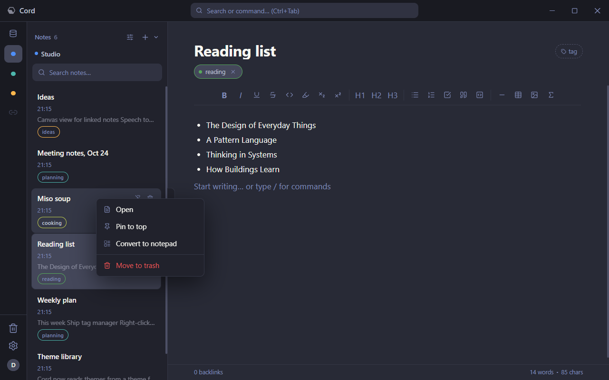
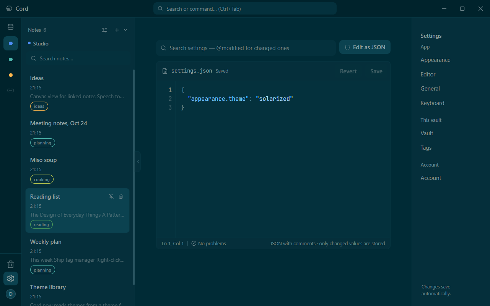

# Changelog

## 2.4.0 - 2026-10-26

### Added

- **Theme library.** Cord reads extra themes from a theme folder, which you can point at any folder (Settings, Appearance, Theme folder). A theme is a folder with `theme.css` and `theme.json`, or a single `.css` file.
- **Theme import** from a folder, a zip, or a public GitHub, GitLab or Codeberg repo. A link to a branch or folder imports just that part. Themes remember where they came from, so you can right-click one and choose **Update from source**.
- **Nine ready-made themes** at [cord-note/cord-themes](https://github.com/cord-note/cord-themes): Catppuccin, Nord, Gruvbox, Rosé Pine, Tokyo Night, Everforest, Solarized, Dracula and Kanagawa, each with a dark and a light version.
- **Tag manager** in Settings, Tags: rename a tag in place, pick its colour, see how many notes use it, add and delete tags. New tags get a colour of their own.
- **Right-click menus** across the app. Notes: open, pin, convert between note and notepad, move to trash. Vaults: open, vault settings, archive. Text fields: cut, copy, paste, select all.

### Changed

- **Theme gallery** redesigned: a compact grid whose previews look like a small Cord window in that theme, and a list mode. Built-in and library themes are shown in separate groups.
- **Tag picker** in the editor and the block menu is now one search-or-create list, with a link to the tag manager.
- **Settings** are grouped into App, This vault and Account. Hold-to-confirm speed sits with the other general settings, idle lock with the account, and the distinct-colour option next to the vault colour picker.
- **settings.json editor** has line numbers, syntax colours, a status line, and a problems list that jumps to the right line.

### Fixed

- Deleting a tag that was used on a notepad block failed.
- Right-clicking outside the editor showed the browser's own menu (Back, Reload, Inspect).
- A renamed or recoloured tag only updated after reopening the note.
- The settings navigation could highlight the chapter above the one on screen.
- The lock screen showed the default theme instead of a chosen library theme.

### Under the hood

- Tags are now soft-deleted (`tags.deleted_at`, an additive migration), and attaching or detaching a tag is written to the operation log.
- Theme CSS is filtered to the public theme API: every rule must be scoped to its own theme, and remote URLs and `@import` are removed. See `docs/theming/public-api.md`.
- The sidecar exits together with Cord and shows up as Cord on Windows.
