# Changelog

## 3.0.0-beta.1

**This is a beta.** Cord 3.0 stores your notes in a new format. Read *Before you upgrade* first.

### Added

- **Active tags.** Tags can carry fields: text, number, checkbox, select, multi-select and date. Everything with a tag, whole notes or single blocks, becomes a row you can fill in.
- **Tag pages.** Open a tag to see its rows as a table or a board, with filters and sorting. Views are saved.
- **Tag views in notes.** Embed a tag's table or board inside any note.
- **Agents.** A new Agents tab lets AI agents such as Claude Desktop and Claude Code search and read your notes, and, if you turn it on, create notes, add text, tag and set fields. You choose which vaults they see. They only reach Cord while it is open and unlocked, over a connection that never leaves your computer. Every call shows up in the tab, and edits appear live in open notes. The plugin and setup for Claude are at [cord-note/cord-mcp](https://github.com/cord-note/cord-mcp).
- **Lock-screen scene pool.** Pick which scenes the lock screen chooses from, in Settings.

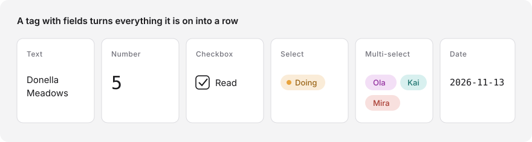

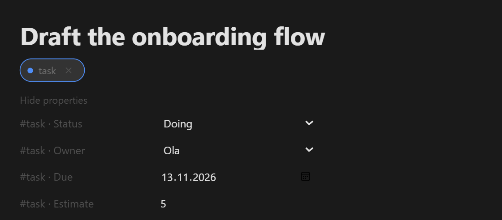

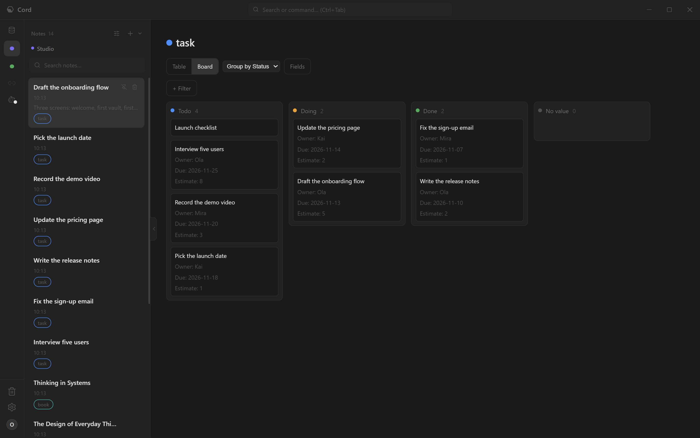

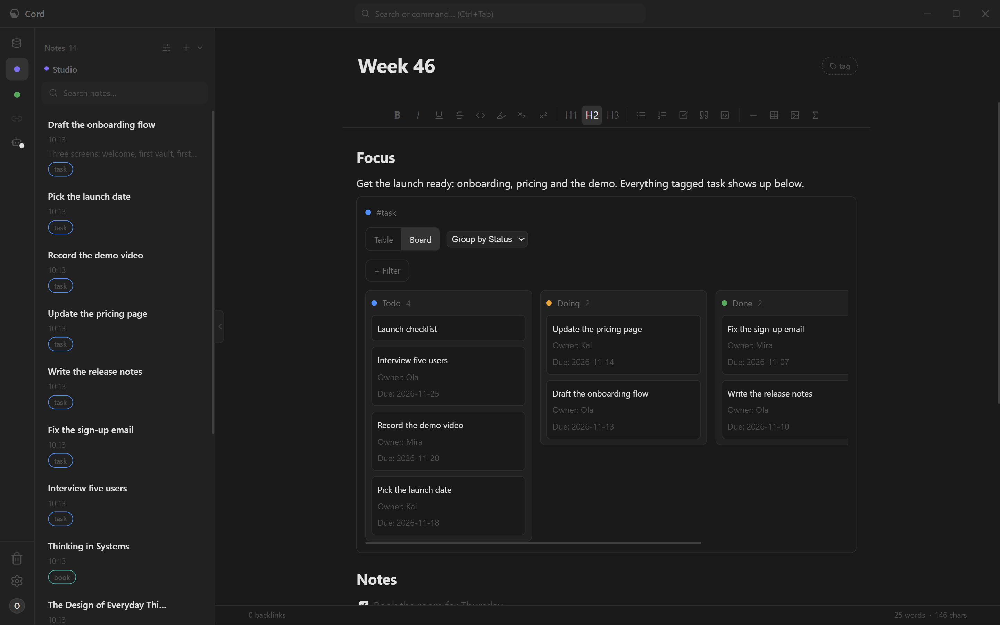

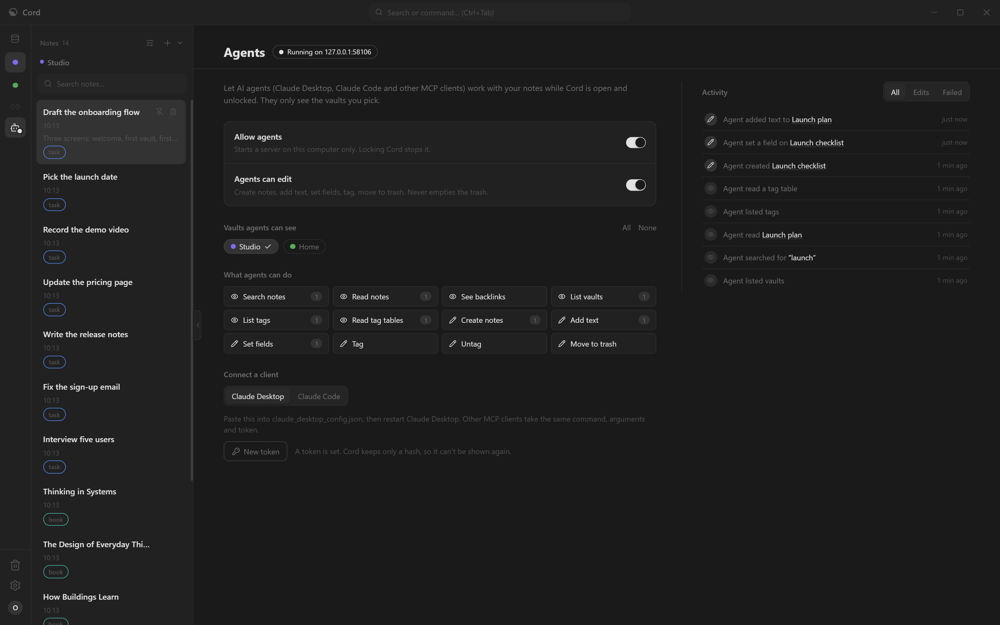

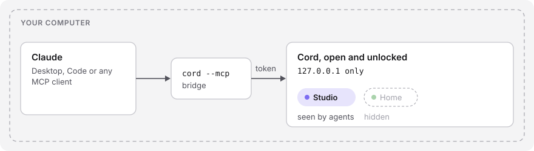

### Changed

- **New core.** Everything that used to run in a separate background process now runs inside the app itself, so there is one process less to start, and nothing to fail on its own.
- **New storage.** Notes are stored in a format built for sync between devices, which comes in a later release.

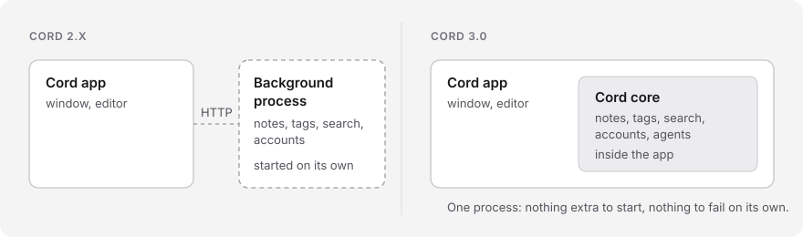

### Before you upgrade

- On first start, Cord 3.0 copies your notes, tags, attachments and settings from the 2.x database into the new format. This happens once and can take a moment on large libraries.
- **Your old data is never changed.** The 2.x `cord.db` stays where it was. If the copy is stopped halfway, it starts over cleanly next time.
- **Going back to 2.x** shows your notes as they were before the upgrade. Anything written in 3.0 doesn't carry back.
- As with any beta, back up your data folder first: `~/.cord/` on Windows and macOS, `~/.local/share/cord/` on Linux.
- The AppImage won't offer this beta as an update. Download it from the release page to try it.

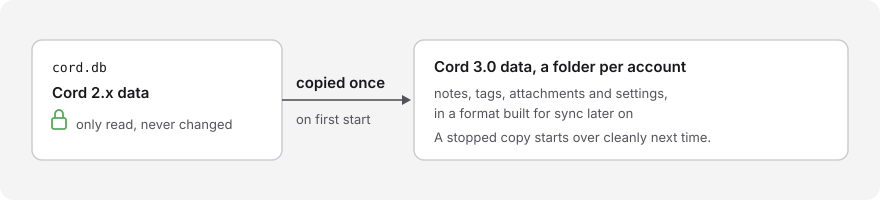

### Under the hood

- The Bun sidecar, Drizzle and `bun:sqlite` are gone. Domain logic lives in a Rust crate, `crates/cord-core`, and Tauri commands call it directly.
- Note bodies are Yjs documents; `body_json` is derived. Every synced write is stamped with a hybrid logical clock and kept in an outbox for sync.
- Each account has its own folder under `users/<id>/` in the data folder; local accounts live in `machine.db`.
- `CORD_DATA_DIR` points Cord at another data folder, for development and tests.

## 2.4.1 - 2026-10-29

### Added

- **Animated lock screen.** The lock screen shows one of several animated dither scenes at random (clouds, a bridge in fog, a flower drawn in digits), drawn with WebGL. Folder themes can ship their own scenes; see `docs/theming/login-scenes.md`.

### Fixed

- The Arch package pointed at the wrong source URL.

## 2.4.0 - 2026-10-26

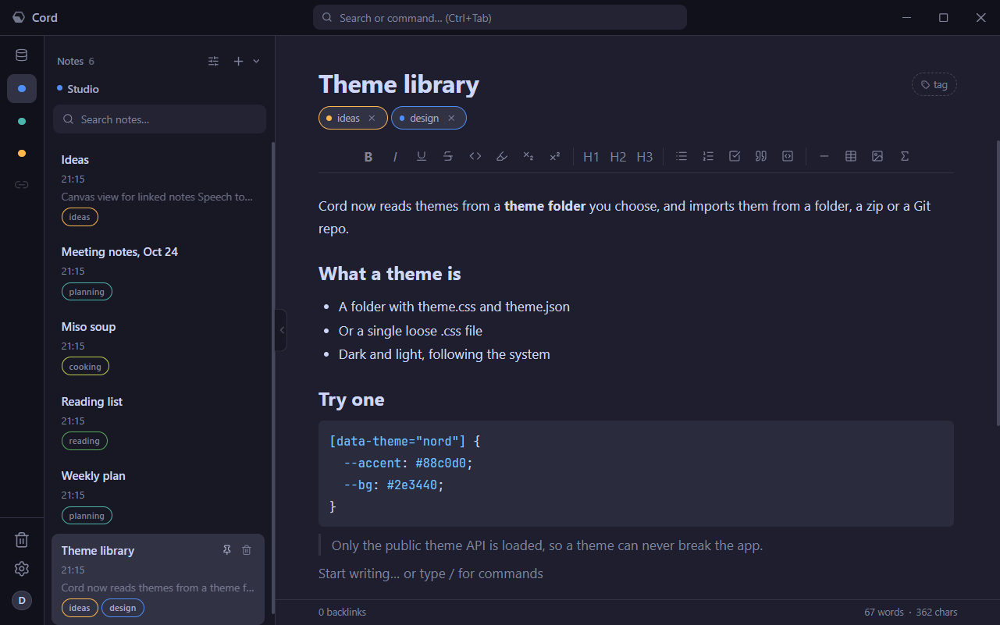

### Added

- **Theme library.** Cord reads extra themes from a theme folder, which you can point at any folder (Settings, Appearance, Theme folder). A theme is a folder with `theme.css` and `theme.json`, or a single `.css` file.
- **Theme import** from a folder, a zip, or a public GitHub, GitLab or Codeberg repo. A link to a branch or folder imports just that part. Themes remember where they came from, so you can right-click one and choose **Update from source**.
- **Nine ready-made themes** at [cord-note/cord-themes](https://github.com/cord-note/cord-themes): Catppuccin, Nord, Gruvbox, Rosé Pine, Tokyo Night, Everforest, Solarized, Dracula and Kanagawa, each with a dark and a light version.
- **Tag manager** in Settings, Tags: rename a tag in place, pick its colour, see how many notes use it, add and delete tags. New tags get a colour of their own.
- **Right-click menus** across the app. Notes: open, pin, convert between note and notepad, move to trash. Vaults: open, vault settings, archive. Text fields: cut, copy, paste, select all.

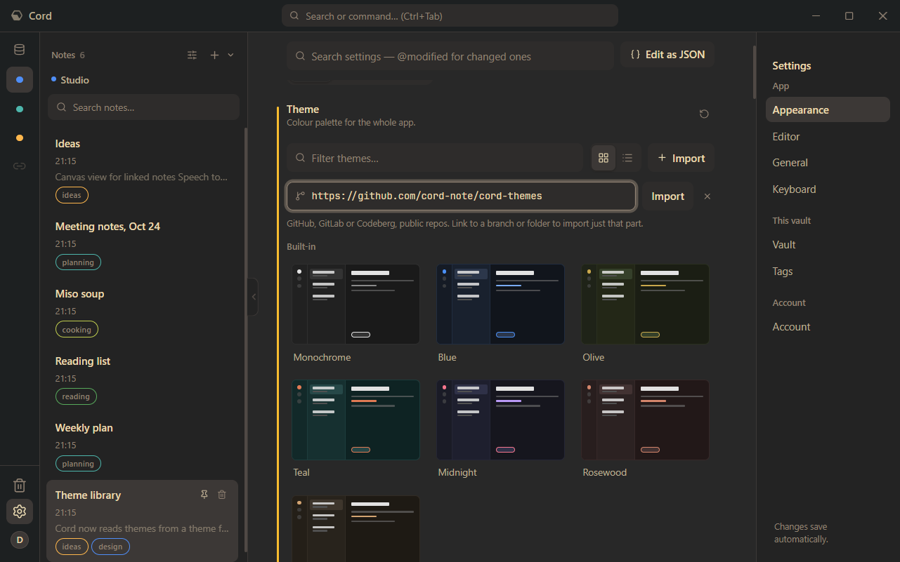

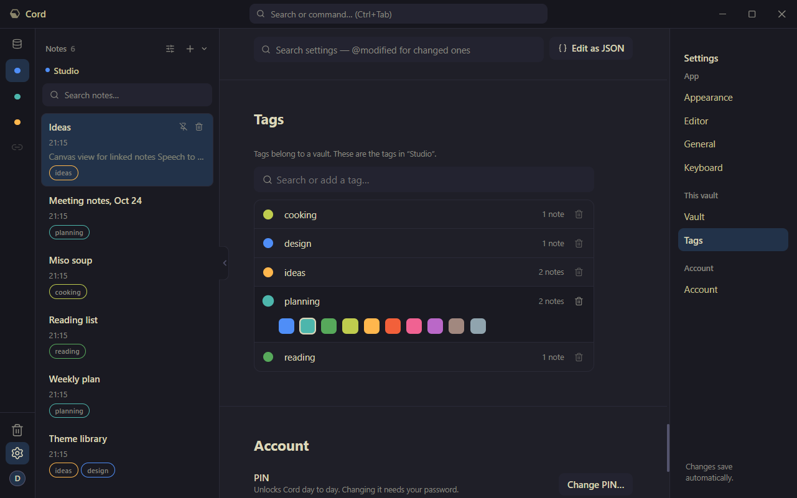

### Changed

- **Theme gallery** redesigned: a compact grid whose previews look like a small Cord window in that theme, and a list mode. Built-in and library themes are shown in separate groups.
- **Tag picker** in the editor and the block menu is now one search-or-create list, with a link to the tag manager.
- **Settings** are grouped into App, This vault and Account. Hold-to-confirm speed sits with the other general settings, idle lock with the account, and the distinct-colour option next to the vault colour picker.
- **settings.json editor** has line numbers, syntax colours, a status line, and a problems list that jumps to the right line.

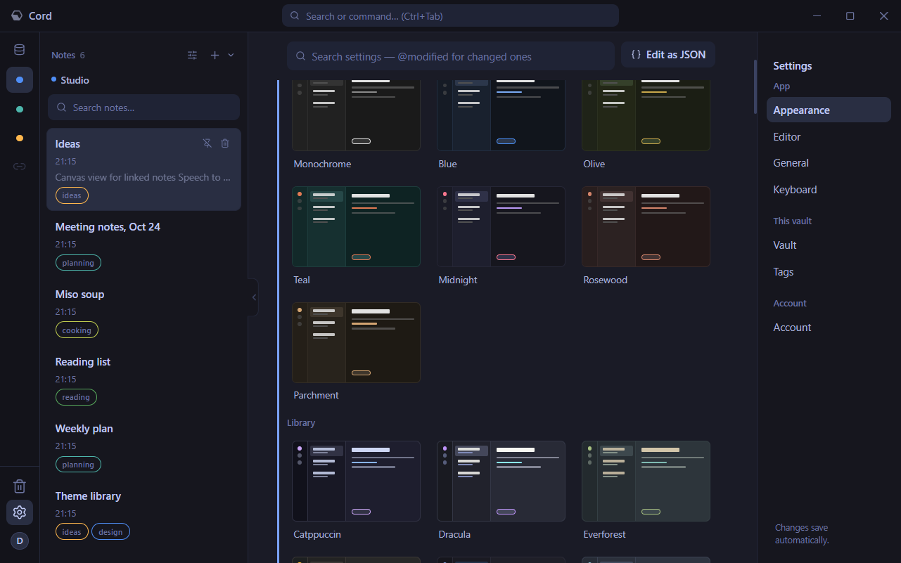

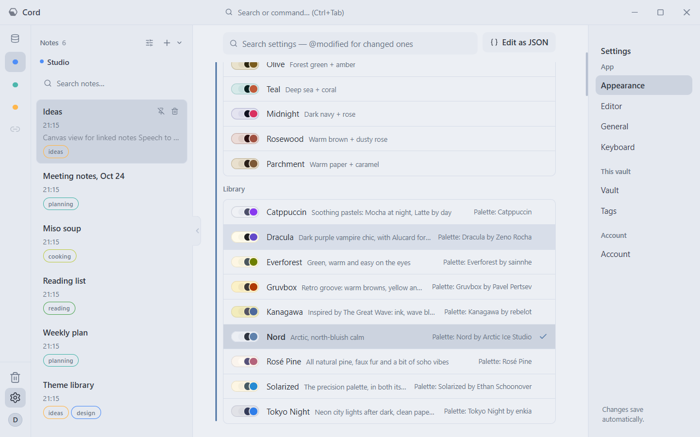

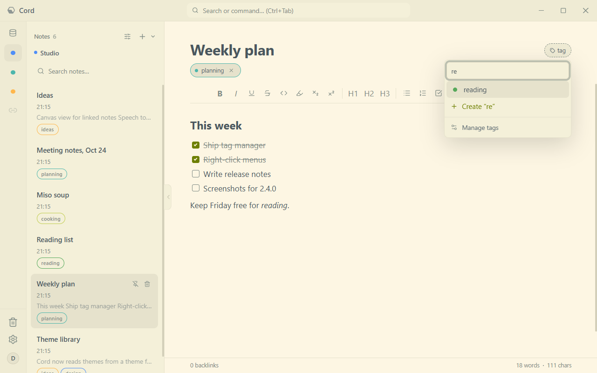

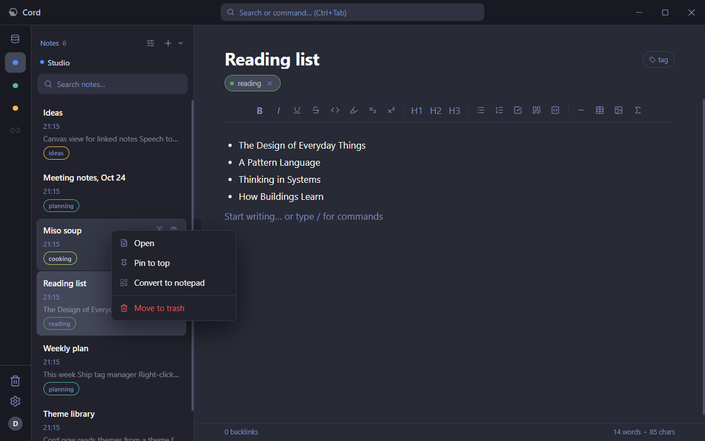

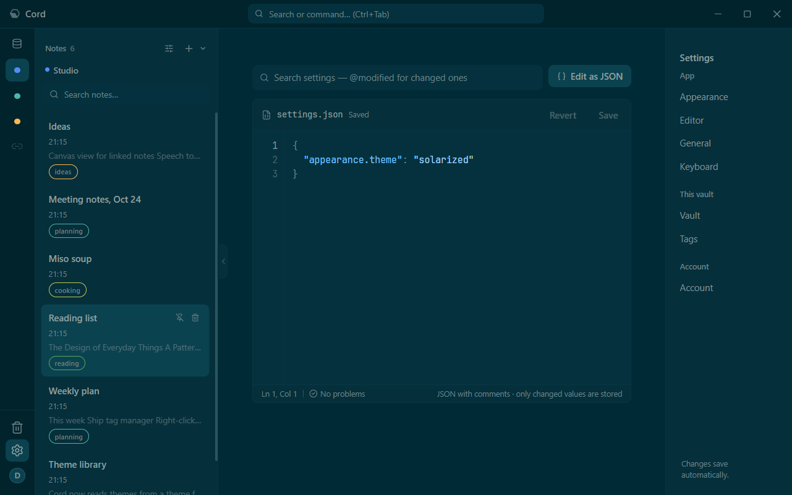

### Fixed

- Deleting a tag that was used on a notepad block failed.
- Right-clicking outside the editor showed the browser's own menu (Back, Reload, Inspect).
- A renamed or recoloured tag only updated after reopening the note.
- The settings navigation could highlight the chapter above the one on screen.
- The lock screen showed the default theme instead of a chosen library theme.

### Under the hood

- Tags are now soft-deleted (`tags.deleted_at`, an additive migration), and attaching or detaching a tag is written to the operation log.
- Theme CSS is filtered to the public theme API: every rule must be scoped to its own theme, and remote URLs and `@import` are removed. See `docs/theming/public-api.md`.
- The sidecar exits together with Cord and shows up as Cord on Windows.
